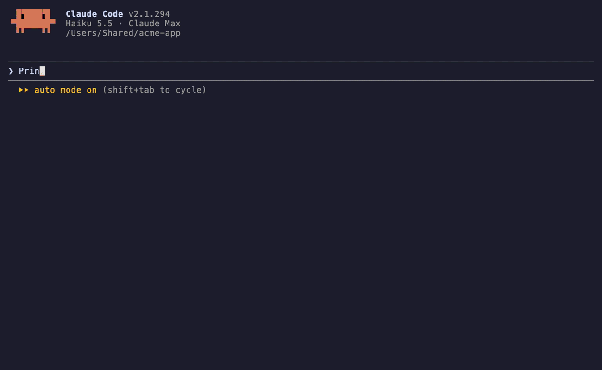

# Encore Mods

Small [Claude Code mods](https://code.claude.com/docs/en/plugins/mods/overview) that make long sessions easier: clickable follow-up prompts, a guard against permanent deletes, live progress, your local and deploy URLs at hand, a paid-API counter and a notification when Claude is done.



*In the demo: `turn-progress` while Claude works, `trash-guard` refusing `rm -rf` (Claude moves the folder to the Trash instead), `next-prompts` turning the follow-ups into buttons (typing `1` highlights it and fills the prompt box) and `session-links` keeping `localhost:5173` one click away.*

Each mod installs on its own. Pick the ones you want.

| Mod | What it does |
| --- | --- |
| [**next-prompts**](plugins/next-prompts) | **Click** a follow-up (or type its digit alone in the empty prompt and pause): it lands in the prompt box, unsent, so you can edit it first. |
| [**trash-guard**](plugins/trash-guard) | Claude never deletes for good: `rm`, `git clean` and `find -delete` outside temp folders are refused, and Claude uses the Trash instead |
| [**turn-progress**](plugins/turn-progress) | While a turn runs: `⏳ 2m 05s · 14 actions · ▰▰▰▱▱▱▱▱▱▱ 3/10 · 2 agents running`. |
| [**session-links**](plugins/session-links) | Collects local dev servers (`http://localhost:5173`) and deploy URLs (Vercel, Netlify, Cloudflare Pages, Fly, Render, Railway, Heroku, or any URL on a line that reads like a deploy log) seen during the session. |
| [**paid-api-meter**](plugins/paid-api-meter) | Counts calls to paid generation APIs made through MCP tools or `curl`: fal, ElevenLabs, HeyGen, Replicate, OpenAI, Runway, Veo, Suno, Stability, Luma, Kling and more. |
| [**done-notify**](plugins/done-notify) | A desktop notification when a turn that took at least 15 seconds ends. |
| [**inline-images**](plugins/inline-images) | Images drawn right in the terminal: Claude gets a `show_image` tool, and pasted images and images Claude reads show up in the transcript. Works in Ghostty, kitty and Orca, with a half-block fallback elsewhere. |

## Install

In Claude Code (2.1.287 or later):

```
/plugin marketplace add benjaminb10/encore-mods
/plugin install next-prompts@encore-mods
```

Repeat the second line for each mod you want, then `/reload-plugins`. To get updates on their own: `/plugin` → **Marketplaces** → **encore-mods** → **Enable auto-update**.

All seven at once, from your shell:

```bash
claude plugin marketplace add benjaminb10/encore-mods
for m in next-prompts trash-guard turn-progress session-links paid-api-meter done-notify inline-images; do
  claude plugin install "$m@encore-mods" --scope user
done
```

## What the mods can reach

Mods run inside Claude Code with your permissions, so here is everything these ones touch:

| Mod | Reaches |
| --- | --- |
| next-prompts | Claude's last reply, your prompt box (fills it when you click, never sends) |
| trash-guard | Bash commands before they run (reads them, refuses deletes) |
| turn-progress | Tool calls and subagent status, for display only |
| session-links | Tool output and replies (finds URLs), `HEAD` requests to your **local** servers, `open` to launch your browser |
| paid-api-meter | Tool calls and their results (counts paid ones), for display only |
| done-notify | Claude's last reply, runs `terminal-notifier`, `osascript` or `notify-send` |
| inline-images | Image files you ask it to show, paste or that Claude reads; runs `sips`, ImageMagick or ffmpeg and copies images into your temp folder |

No mod sends anything over the network, apart from session-links checking your own localhost servers.

## Develop

```bash
claude --plugin-dir plugins/next-prompts   # hot-reloads on save
claude plugin validate plugins/next-prompts
claude plugin test plugins/next-prompts
```

Issues and pull requests are welcome.

## License

[MIT](LICENSE) © Benjamin Benoudis. Made by the author of [Encore Screen](https://encorescreen.com).
