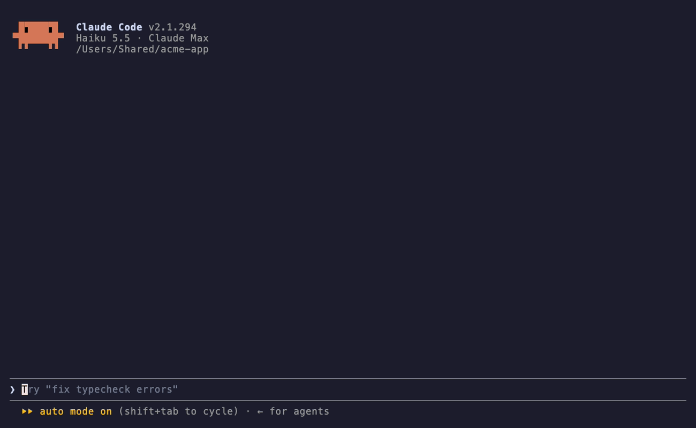

# Paste peek

A [Claude Code mod](https://code.claude.com/docs/en/plugins/mods/overview) from [Encore Mods](../../README.md). Read what you pasted before you send it.



Claude Code folds a long paste into `[Pasted text #12 +26 lines]`, and there's no way to see it again before sending. This mod adds a quiet row above the prompt for each placeholder still in the box:

```
[ View ] Pasted text #12 · 27 lines · “Here is the spec to review…”
```

- **View** (or `v` once the row has the focus, after `ctrl+x` `Tab`) opens the whole text in a pane; give it focus with Tab and scroll with the arrows, however long it is. The button turns into **Hide** to close it.
- Erase the placeholder from the prompt, or send the prompt, and the preview goes away.
- `/paste` opens the last pasted text.

How it works: plugins can't read what's behind a placeholder before the prompt is sent (a paste doesn't even raise an edit event). So when a new placeholder shows up, the mod reads the clipboard, which still holds what you just pasted (`pbpaste` on macOS, `wl-paste` or `xclip` on Linux), and keeps it only if its line count matches the placeholder's. Nothing is stored on disk or sent anywhere. If you copy something else within a second of pasting, the row simply doesn't show.

## Install

```
/plugin marketplace add benjaminb10/encore-mods
/plugin install paste-peek@encore-mods
```

Then `/reload-plugins` or restart Claude Code. Needs Claude Code 2.1.287 or later.

## Try it without installing

```bash
git clone https://github.com/benjaminb10/encore-mods
claude --plugin-dir encore-mods/plugins/paste-peek
```
